<picture>
  <source
    media="(prefers-color-scheme: dark)"
    srcset="./dark.svg"
  >
  <source
    media="(prefers-color-scheme: light)"
    srcset="./light.svg"
  >
  
</picture>

<h1 align="center">Firudin Maniyev</h1>

  <b>Fullstack Developer</b> · Bakı, Azərbaycan 
  React · TypeScript · Next.js · Tailwind CSS · ASP.NET Core · SQL Server

  
  
  
  

---

## 🧭 Haqqımda

Salam, mən Firudin. **Fullstack Developer** olaraq React, TypeScript və Tailwind CSS ilə müasir, responsiv veb tətbiqlər hazırlayıram. Komponent əsaslı inkişaf, təmiz kod və istifadəçi təcrübəsinə önəm verirəm.

Müxtəlif layihələrdə və hackatonlarda iştirak edərək praktiki təcrübə qazanıram və problemlərin effektiv həllinə fokuslanıram. Süni intellekt dəstəkli inkişaf alətlərindən istifadə edir, öyrəndiyim yeni texnologiyaları real layihələrdə tətbiq edirəm.

> *İdeyaları funksional rəqəmsal məhsullara çevirirəm.*

### 🎯 Fokus sahələri

- **Frontend** — React, TypeScript, Next.js, Tailwind CSS, responsive dizayn, komponent əsaslı arxitektura
- **Backend** — C#, ASP.NET Core MVC / Web API, REST API, JWT, Swagger
- **Verilənlər bazası** — Microsoft SQL Server, MySQL
- **AI ilə dəstəklənən inkişaf** — MCP, Skills, Agents, Codex, Claude, Cursor, Antigravity, Replit AI, Lovable, MiniMax
- **UI/UX** — Figma, responsive design, frontend testləri
- **Alətlər** — Git, GitHub, Docker, Postman, VS Code, Visual Studio, Vite, npm, WordPress

---

## 🛠️ Texnologiyalar

<table>
  <tr>
    <td valign="top" width="50%">
      <b>Frontend</b>  
      
      
      
      
      
      
      
      
      
      
    </td>
    <td valign="top" width="50%">
      <b>Backend · Database · DevOps</b>  
      
      
      
      
      
      
      
      
      
      
    </td>
  </tr>
</table>

**Dil bilikləri:** Azərbaycan · Rus · İngilis · Türk

---

## 💼 Təcrübə

| Şirkət | Rol | Müddət | Məkan |
|---|---|---|---|
| **NV Studio Agency** | Frontend Developer Intern | 09/2026 – 10/2026 | Remote |
| **DevJoint** | Frontend Developer Intern | 07/2026 – 08/2026 | Remote |
| **Millisoft Studio** | Frontend Developer Intern | 03/2026 – 04/2026 | Bakı, Azərbaycan |
| **“Surv” Startup Moelven** | Frontend Developer | 11/2025 – 03/2026 | Remote |

<b>NV Studio Agency</b> — Frontend Developer Intern <i>(09/2026 – 10/2026)</i>

- Tapşırıq əsaslı işlərdə komponentlər hazırladım və mövcud kodu optimallaşdırdım.
- React, TypeScript və Tailwind CSS ilə responsiv interfeyslər qurdum.
- Verilmiş texniki tapşırıqları icra edərək layihə funksionallıqlarını təkmilləşdirdim.
- Komanda ilə əməkdaşlıq edərək layihələrin hazırlanması və test proseslərində iştirak etdim.

<b>DevJoint</b> — Frontend Developer Intern <i>(07/2026 – 08/2026)</i>

- HTML, CSS və JS ilə 100% responsiv və accessible veb səhifələr kodlaşdırdım.
- Vanilla JS ilə interaktiv drag and drop Kanban tətbiqi hazırladım.
- React və REST API ilə axtarış, pagination və data yüklənməsini optimallaşdırdım.
- React ilə protected route-lar, qlobal state və tam validasiyalı Auth sistemi qurdum.

<b>Millisoft Studio</b> — Frontend Developer Intern <i>(03/2026 – 04/2026)</i>

- React, TypeScript və Tailwind CSS ilə 20+ reusable komponent yaratdım.
- Mövcud dizaynları pixel-perfect və 100% responsiv interfeyslərə çevirdim.
- REST API inteqrasiyası ilə məlumat mübadiləsini qurub performansı artırdım.
- İki nəfərlik dev komandasında real biznes layihələrinin hazırlanmasında iştirak etdim.

<b>“Surv” Startup Moelven</b> — Frontend Developer <i>(11/2025 – 03/2026)</i>

- 100% responsiv və böyüməyə meyilli frontend arxitekturası qurdum.
- Kodun yazılma sürətini artıran 15+ reusable komponent inkişaf etdirdim.
- REST API inteqrasiyası və qlobal state idarəetməsi ilə məlumat axınını optimallaşdırdım.
- Agile komanda mühitində sıx əməkdaşlıq edərək layihələrin inkişafına töhfə verdim.

---

## 🚀 Seçilmiş layihələr

| Layihə | Təsvir | Əlaqə |
|---|---|---|
| **ManiQR Studio** | Məlumatları daxil edib QR kodlar yaratmağa imkan verən web tətbiqi | [Kod](https://github.com/FirudinManiyev/qr_kod_app) · [Demo](https://qr-kod-app-firudin.vercel.app) |
| **ManiConvert** | Müxtəlif şəkil formatlarını çevirməyə imkan verən image converter | [Kod](https://github.com/FirudinManiyev/image_converter_firudin) · [Demo](https://image-converter-firudin.vercel.app) |
| **ManiPalette** | İstifadəçilərin custom gradientlər yaratdığı web tətbiqi | [Kod](https://github.com/FirudinManiyev/gradient_generator) · [Demo](https://manipalette-gradient.vercel.app) |
| **ManiBarcode** | Məlumatlardan barkod yaratma, yükləmə və paylaşma tətbiqi | [Kod](https://github.com/FirudinManiyev/mani_barcode) · [Demo](https://manibarcode.vercel.app) |
| **ManiWheel** | İstifadəçinin seçimlərindən sadə niyət əldə etməsi üçün wheel-spinner | [Kod](https://github.com/FirudinManiyev/mani_wheel) · [Demo](https://maniwheel.vercel.app) |
| **Recipe Finder** | Resept axtarışı, idarə edilməsi və kateqoriyalaşdırılması üçün full-stack tətbiq | [Kod](https://github.com/FirudinManiyev/recipe_finder) |
| **Firudin Maniyev Portfolio** | Şəxsi portfolio və layihələrin təqdimatı | [Kod](https://github.com/FirudinManiyev/portfolio) · [Demo](https://firudinmaniyev.vercel.app) |
| **World Telecom Clone** | Elektronika məhsulları və e-ticarət funksiyalarını əhatə edən platforma | [Kod](https://github.com/FirudinManiyev/worldtelecom) · [Demo](https://worldtelecomclone.vercel.app) |
| **ParkCinema Clone** | ParkCinema saytının clone versiyası | [Kod](https://github.com/FirudinManiyev/park_cinema) · [Demo](https://park-cinema-six.vercel.app) |
| **Master School Redesign** | Təhsil platforması üçün müasir, tam responsiv landing page | [Kod](https://github.com/FirudinManiyev/masterschool) · [Demo](https://masterschoolfirudin.vercel.app) |
| **SuperTraders** | Məhsul tövsiyəsi, iş elanları, CV analizi və maliyyə analitikası olan al-dəstəkli ticarət platforması | [Kod](https://github.com/FirudinManiyev/business_ai_buildathon) |
| **CampusConnect** | Tələbələr kabineti kimi fəaliyyət göstərən hackathon layihəsi | [Kod](https://github.com/JavadShukurlu/CampusConnectHackaton) |
| **KiberEduAz** | Məktəb kollecləri üçün real ssenarilər, interaktiv tapşırıqlar və oyunlaşdırılmış öyrənmə platforması | [Kod](https://github.com/1brah1m0f/KiberEduAz) · [Demo](https://kiber-edu-az-one.vercel.app) |
| **Standart Group** | Korporativ kimliyə uyğun müasir və responsiv veb-sayt | [Demo](https://bakustandartgroupmmc.az) |
| **Duru Klinik** | Çoxdilli dəstəkli, responsiv klinika veb-saytı | [Demo](https://wordpress-1399814-6729763.cloudwaysapps.com) |
| **Parrus Az** | Parket və təbii ağac döşəmə məhsullarının kataloqu və korporativ veb-sayt | [Demo](https://wordpress-1399814-6699772.cloudwaysapps.com) |
| **Dr. Emin Haqverdiyev** | Peşəkar fəaliyyət, tibbi xidmətlər və pasiyent rəylərini əhatə edən çoxdilli həkim veb-saytı | [Demo](https://wordpress-1399814-6752300.cloudwaysapps.com) |

---

## 🎓 Təhsil

| Müəssisə | Sahə | Müddət |
|---|---|---|
| **Azərbaycan Memarlıq və İnşaat Universiteti** | İnformasiya Texnologiyaları — Bakalavr | 2023 – 2027 |
| **Div Academy** | Frontend Development | 2024 – 2025 |
| **Code Academy – CFF** | Software Development | 2025 – 2026 |
| **Holberton School** | Full Stack Web Specialization | 2025 – 2026 |

## 🏅 Sertifikatlar

- **Div Academy** — Frontend Development Diploma, I dərəcə (2025)
- **Code Academy – CFF** — Software Development Diploma (2026)
- **AZCON Future Tech Hackathon** — Participant Certificate (2026)
- **Code8 Hackathon** — Participant Certificate (2026)
- **AI4CYBER Hackathon** — Participant Certificate (2026)
- **NV ProjectLab** — Internship Program Certificate (2026)
- **DevJoint** — Certificate (2026)
- **CyberBridge** — Project Certificate (2025)
- **IBM — Software Developer Career Guide and Interview Preparation**, Coursera (2025)
- **Oracle SQL**, DataPrime Academy (2025)
- **Microsoft Excel**, DataPrime Academy (2025)
- **GIT, GitLab, GitHub Fundamentals for Software Developers**, Udemy (2025)
- **Lifelong Development Tasks**, Secret Academy (2024)

## 🧩 Yumuşaq bacarıqlar

- Mürəkkəb problemlərin analitik təhlili və optimal arxitektur həllərinin tətbiqi
- Agile mühitində effektiv komanda işi və aydın texniki kommunikasiya
- Davamlı öyrənmə mədəniyyəti və yeni texnologiyalara sürətli adaptasiya
- Nəticəyönümlü iş etikası və **Təmiz Kod** (Clean Code) prinsiplərinə diqqət
- Tapşırıqların düzgün prioritetləşdirilməsi (Notion, ClickUp) və deadline-lara ciddi riayət

---

## 📊 GitHub

<picture>
  <source media="(prefers-color-scheme: dark)" srcset="https://github-readme-stats.vercel.app/api?username=FirudinManiyev&show_icons=true&hide_border=true&theme=radical&rank=4&include_all_commits=true">
  <source media="(prefers-color-scheme: light)" srcset="https://github-readme-stats.vercel.app/api?username=FirudinManiyev&show_icons=true&hide_border=true&theme=default&rank=4&include_all_commits=true">
  
</picture>

<picture>
  <source media="(prefers-color-scheme: dark)" srcset="https://github-readme-stats.vercel.app/api/top-langs/?username=FirudinManiyev&layout=compact&hide_border=true&theme=radical">
  <source media="(prefers-color-scheme: light)" srcset="https://github-readme-stats.vercel.app/api/top-langs/?username=FirudinManiyev&layout=compact&hide_border=true&theme=default">
  
</picture>

---

## 📬 Əlaqə

- **Email** — [firudinmaniyev@gmail.com](mailto:firudinmaniyev@gmail.com)
- **Telefon** — +994 50 769 36 54
- **Portfolio** — [firudinmaniyev.vercel.app](https://firudinmaniyev.vercel.app)
- **GitHub** — [github.com/FirudinManiyev](https://github.com/FirudinManiyev)
- **LinkedIn** — [linkedin.com/in/firudin-maniyev-4843242b7](https://www.linkedin.com/in/firudin-maniyev-4843242b7/)
- **Instagram** — [@firudin.coder](https://www.instagram.com/firudin.coder)
- **Məkan** — Bakı, Azərbaycan

---

Banner <code>dark.svg</code> və <code>light.svg</code> GitHub-un tema seçimino uyğun avtomatik dəyişir.
